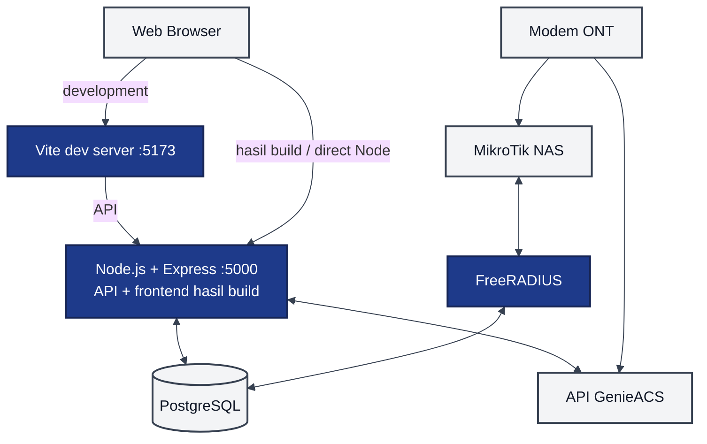
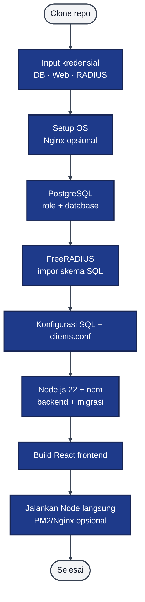

# RANIAH.NET ISP Billing System

<div align="center">

[](https://github.com/oriza23/billing)

**Repositori resmi:** **[https://github.com/oriza23/billing](https://github.com/oriza23/billing)**


### Sistem All-in-One terpusat untuk manajemen ISP mandiri

**Node.js** · **React** · **PostgreSQL** · **FreeRADIUS** · **GenieACS (TR-069)**

Billing pelanggan · RADIUS **PPPoE & Hotspot** · ACS provisioning ONT **Fiberhome / ZTE** · integrasi **MikroTik** NAS.

</div>

---

## Tentang proyek

**RANIAH.NET ISP Billing System (Utama)** adalah panel operasional ISP dalam satu tempat: tagihan dan CRM, autentikasi pelanggan lewat **FreeRADIUS**, serta manajemen modem lewat **GenieACS**. Frontend memakai **React** (Vite), backend memakai **Node.js + Express** (`server.js` dan folder `backend/`), dan **PostgreSQL** adalah database runtime untuk billing dan tabel RADIUS. MariaDB tidak diperlukan untuk menjalankan aplikasi.

Saat development, backend dapat dijalankan langsung dengan Node.js di port **5000** dan frontend Vite secara opsional di port **5173**. Hasil build frontend (`frontend/dist`) juga dapat disajikan langsung oleh Express. Skrip **`install.sh`** mengikuti mode Node langsung secara default; **PM2** dan **Nginx** hanya dipasang bila diaktifkan untuk deployment produksi.

---

## Daftar isi

- [Preview antarmuka](#preview-antarmuka)
- [Diagram arsitektur](#diagram-arsitektur--aliran-data)
- [Struktur proyek](#struktur-proyek)
- [Pengembangan lokal](#pengembangan-lokal-nodejs-langsung)
- [Diagram alur installer](#diagram-alur-installer-installsh)
- [Deployment server](#deployment-server)
- [Input install.sh](#input-yang-diminta-installsh)
- [Kebutuhan sistem & pasca-instalasi](#kebutuhan-sistem--pasca-instalasi)
- [Dokumentasi lanjutan](#dokumentasi-lanjutan)

---

## Preview antarmuka

Letakkan tangkapan layar di **`assets/images/`** agar GitHub menampilkannya.

| Layar | Berkas |
|-------|--------|
| Dashboard utama | `assets/images/dashboard.png` |
| Manajemen ACS & ONT | `assets/images/acs-panel.png` |
| Hotspot & RADIUS | `assets/images/hotspot.png` |
| PPPoE & langganan | `assets/images/pppoe.png` |


---

## Diagram arsitektur & aliran data



---

## Struktur proyek

```text
.
├── server.js                 # Entry point API Express dan server frontend
├── database.js               # Koneksi PostgreSQL
├── backend/
│   ├── routes/               # Endpoint API
│   ├── middleware/           # Autentikasi dan otorisasi
│   ├── pppoe_isolir/         # Isolir PPPoE
│   └── ...                   # Modul ACS, pelanggan, RADIUS, dan lainnya
├── frontend/
│   ├── src/                  # Aplikasi React
│   ├── public/               # Aset statis
│   └── dist/                 # Hasil build, dibuat oleh Vite
├── utils/                    # Utilitas backend dan cron
├── scripts/                  # Setup admin, migrasi, dan administrasi
├── docs/                     # Dokumentasi teknis
├── deploy/freeradius/        # Konfigurasi dan panduan FreeRADIUS
├── test/                     # Tes Node.js
├── assets/images/            # Gambar dokumentasi
├── uploads/                  # File runtime yang diunggah
├── .env.example              # Contoh konfigurasi backend
├── package.json              # Dependensi dan perintah backend
└── install.sh                # Installer deployment server
```

`frontend/dist` adalah hasil generate dan tidak perlu diedit langsung. `backend/pg_compat.js` menerjemahkan sebagian sintaks query lama ke PostgreSQL; file ini tidak membuat koneksi ke MariaDB. Skrip dan dokumentasi migrasi MariaDB hanya untuk sistem legacy.

---

## Pengembangan lokal (Node.js langsung)

Gunakan **Node.js 22.x** dan **npm 12.x**. Pastikan PostgreSQL sudah berjalan dan siapkan database/role sesuai variabel di `.env`.

```bash
cp .env.example .env
# Edit .env: DB_HOST, DB_PORT, DB_USER, DB_PASSWORD, DB_NAME, dan JWT_SECRET
# Ganti semua nilai contoh dengan kredensial kuat; jangan commit .env.
npm install
npm start
```

Backend berjalan di `http://localhost:5000`. Perintah `npm start` menjalankan `node server.js`; bila `frontend/dist/index.html` tersedia, Express juga menyajikan aplikasi React pada port yang sama.

Untuk hot reload frontend, buka terminal kedua:

```bash
cd frontend
npm install
npm run dev
```

Buka `http://localhost:5173`. Vite mengarahkan permintaan API ke backend pada port **5000**. Port `5173` adalah server development dan jangan dibuka ke jaringan publik untuk deployment.

Untuk build frontend dan menyajikannya melalui Node:

```bash
cd frontend
npm run build
cd ..
npm start
```

Mode langsung ini cocok untuk development. Node melayani HTTP pada port `5000`; HTTPS, domain, dan pengelolaan proses saat production perlu dikonfigurasi terpisah.

---

## Diagram alur installer (`install.sh`)



---

## Deployment server

### Prasyarat

- **OS:** Debian 11 atau Ubuntu 22.04 LTS ke atas.
- **Node.js:** 22.x.
- PostgreSQL dan akses root/sudo untuk installer.
- Koneksi internet dan port layanan yang dibutuhkan tidak bentrok.

### Perintah (repositori resmi)

Clone dari **[github.com/oriza23/billing](https://github.com/oriza23/billing)**:

```bash
sudo mkdir -p /var/www
cd /var/www
sudo git clone https://github.com/oriza23/billing.git billing
cd billing
chmod +x install.sh scripts/setup-admin.js
```

> `git clone` memakai URL `.../billing.git` (format standar Git). Halaman repo di browser: **https://github.com/oriza23/billing**

### Instalasi server (default Node langsung)

Secara default installer menyiapkan PostgreSQL, FreeRADIUS, Node.js 22.x, npm 12.x, dependensi backend/frontend, dan build React. PM2 dan Nginx tidak dipasang; setelah instalasi selesai, jalankan backend secara manual:

```bash
sudo ./install.sh
cd /var/www/billing
npm start
```

### Deployment produksi dengan PM2 dan Nginx

Aktifkan kedua komponen secara eksplisit:

```bash
sudo USE_PM2=1 USE_NGINX=1 ./install.sh
```

Nginx menjadi reverse proxy pada port 80 dan PM2 menjaga proses backend tetap berjalan. Installer belum mengatur sertifikat TLS; HTTPS memerlukan konfigurasi sertifikat terpisah.

Untuk memakai PM2 tanpa Nginx, jalankan `sudo USE_PM2=1 ./install.sh`. Untuk Node langsung tanpa kedua komponen, gunakan default atau tetapkan `USE_PM2=0 USE_NGINX=0`. Akses langsung menggunakan `http://IP-SERVER:5000`.

### Hardening: service systemd tanpa root

Backend bisa dijalankan sebagai pengguna sistem `billing` lewat unit systemd, sehingga proses web tidak memegang akses root penuh:

```bash
sudo deploy/install-service.sh
```

Skrip memasang `billing.service` (`User=billing`, `Restart=always`, `ProtectSystem=strict`, hanya `uploads/` dan `/etc` yang writable) dan `/etc/sudoers.d/billing` yang hanya mengizinkan restart PostgreSQL/FreeRADIUS serta perubahan zona waktu via `sudo -n`. Bila `FREERADIUS_RESTART_ON_SYNC=1` dipakai, `FREERADIUS_SERVICE` harus tetap `freeradius` agar cocok dengan sudoers.

Catatan keamanan tambahan:

- `CORS_ORIGINS` (lihat `.env.example`) membatasi origin API; kosongkan hanya bila memang perlu akses lintas origin dari mana saja.
- `server.js` mengirim header `Content-Security-Policy`, `X-Frame-Options`, `X-Content-Type-Options`, `Referrer-Policy`, `Permissions-Policy`, dan HSTS saat lewat HTTPS.
- fail2ban (jail `sshd`) melindungi SSH yang masih memakai login root/password.
- Panel saat ini masih tahap pengembangan dan diakses lewat HTTP; HSTS baru berlaku setelah dipasang reverse proxy TLS.
- Port GenieACS (3000/7547/7567) sudah dibuka di UFW **secara sengaja** sebagai persiapan; layanan ACS menyusul, jadi port itu wajar belum ada yang listen.
- `/api/system/health` berada di belakang `requireAuth`, sehingga monitoring eksternal perlu token JWT.
- Untuk monitoring tanpa JWT tersedia `GET /healthz`: publik, hanya membalas `{ status: "ok" }` (200) atau `{ status: "degraded" }` (503) tanpa detail internal. Set `HEALTH_TOKEN` dan kirim header `X-Health-Token` bila ingin detail database/RADIUS (latensi, state layanan).


### Verifikasi

```bash
sudo systemctl status postgresql freeradius --no-pager
# Jika USE_NGINX=1:
sudo systemctl status nginx --no-pager
# Jika USE_PM2=1:
pm2 ls
curl -s -o /dev/null -w "HTTP %{http_code}\n" http://127.0.0.1:5000/
```

---

## Input yang diminta `install.sh`

| Prompt | Variabel | Default | Catatan |
|--------|----------|---------|---------|
| Nama Database | `DB_NAME` | `orizabil` | PostgreSQL billing + RADIUS |
| Username DB | `DB_USER` | `oriza` | Role PostgreSQL |
| Password DB | `DB_PASS` | acak | Enter = otomatis |
| Username Web Admin | `WEB_ADMIN` | `admin` | Login panel |
| Password Web Admin | `WEB_PASS` | — | **Wajib**, min. 8 karakter |
| RADIUS Secret | `RADIUS_SECRET` | acak | Secret MikroTik ↔ FreeRADIUS |
| Nama lengkap admin | — | = WEB_ADMIN | Profil superadmin |
| Domain/IP reverse proxy | `server_name` | `_` | Hanya jika `USE_NGINX=1` |
| Lanjut? | — | `N` | Ketik `y` untuk melanjutkan |

---

## Kebutuhan sistem & pasca-instalasi

### Spesifikasi minimum

| Aspek | Minimum | Disarankan |
|--------|---------|------------|
| OS | Debian 11 / Ubuntu 22.04 | LTS terbaru |
| CPU | 2 vCPU | 4 vCPU |
| RAM | 2 GB | 4–8 GB |
| Disk | 20 GB SSD | 40 GB+ SSD |

**Dependensi (via installer):** PostgreSQL, FreeRADIUS + modul PostgreSQL, Node.js **22.x**, npm **12.x**, dan UFW. PM2/Nginx hanya dipasang jika `USE_PM2=1` / `USE_NGINX=1`.

### Port layanan

| Port | Layanan |
|------|---------|
| 5000/tcp | Node.js + Express (API dan frontend build) |
| 5173/tcp | Vite development saja; jangan dibuka ke publik |
| 80/tcp | Nginx → Node.js, jika `USE_NGINX=1` |
| 443/tcp | HTTPS setelah sertifikat dan konfigurasi TLS disiapkan terpisah |
| 5432/tcp | PostgreSQL (localhost) |
| 1812/1813 UDP | FreeRADIUS |
| 7547, 7567, 3000/tcp | GenieACS (jika di host yang sama) |

### Pasca-instalasi

1. Buka **`http://IP-SERVER/`** bila memakai Nginx, atau **`http://IP-SERVER:5000/`** bila Node diakses langsung; login superadmin.
2. Isi router MikroTik, profil PPPoE/Hotspot, server GenieACS (`127.0.0.1:7557` untuk NBI lokal).
3. Jika memakai installer, cek proses dengan `pm2 ls`. Pada development, jalankan `npm start` di terminal.
4. Backup rutin `pg_dump` dan file `.env`.

### Winbox — MikroTik → RADIUS

1. **Radius** → **+**
2. **Address:** IP server billing  
3. **Secret:** sama dengan **RADIUS_SECRET** saat `install.sh`  
4. **Auth:** `1812` · **Acct:** `1813` · centang **ppp** / **hotspot**  
5. Aktifkan **accounting** untuk pelaporan sesi.

Detail isolir: [`docs/PPPOE_ISOLIR.md`](docs/PPPOE_ISOLIR.md).

Banyak router/NAS dalam satu billing (sinkron otomatis ke tabel `nas` FreeRADIUS): [`docs/MULTI_NAS.md`](docs/MULTI_NAS.md).

---

## Dokumentasi lanjutan

| Dokumen | Isi |
|---------|-----|
| [`docs/DATABASE-POSTGRESQL.md`](docs/DATABASE-POSTGRESQL.md) | PostgreSQL & variabel lingkungan |
| [`docs/MIGRASI-MARIADB-KE-POSTGRESQL.md`](docs/MIGRASI-MARIADB-KE-POSTGRESQL.md) | Migrasi legacy |
| [`deploy/freeradius/README.md`](deploy/freeradius/README.md) | Modul FreeRADIUS |

---

<div align="center">

**RANIAH.NET** · [github.com/oriza23/billing](https://github.com/oriza23/billing)

</div>