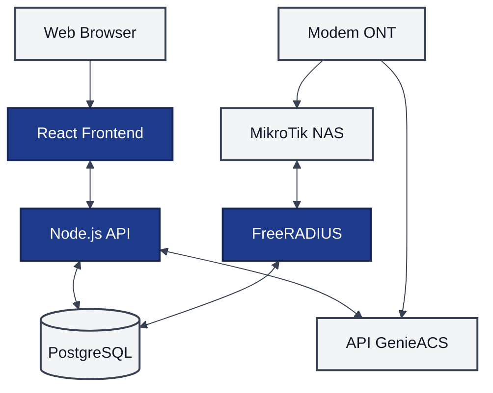
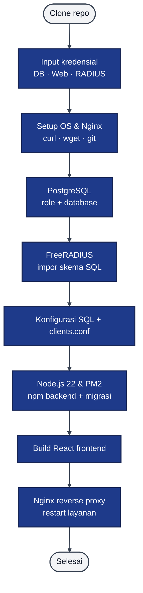

# RANIAH.NET ISP Billing System

<div align="center">


### Sistem All-in-One terpusat untuk manajemen ISP mandiri

**Node.js** · **React** · **PostgreSQL** · **FreeRADIUS** · **GenieACS (TR-069)**

Billing pelanggan · RADIUS **PPPoE & Hotspot** · ACS provisioning ONT **Fiberhome / ZTE** · integrasi **MikroTik** NAS.

**Repositori resmi:** [https://github.com/oriza23/billing.git](https://github.com/oriza23/billing.git)

</div>

---

## Tentang proyek

**RANIAH.NET ISP Billing System (Utama)** adalah panel operasional ISP dalam satu tempat: tagihan dan CRM, autentikasi pelanggan lewat **FreeRADIUS**, serta manajemen modem lewat **GenieACS**. Aplikasi web memakai **React** (Vite) dan API **Express** (`server.js` + folder `backend/`), dengan **PostgreSQL** sebagai satu sumber data untuk modul billing dan tabel RADIUS.

Deploy produksi standar: **Nginx** (port 80) sebagai reverse proxy ke Node.js (port **5000**), diproses **PM2**, dan diatur oleh skrip **`install.sh`** untuk server **Debian 11** / **Ubuntu 22.04**.

---

## Daftar isi

- [Preview antarmuka](#preview-antarmuka)
- [Diagram arsitektur](#diagram-arsitektur--aliran-data)
- [Diagram alur instalasi](#diagram-alur-instalasi-installsh)
- [Panduan instalasi](#panduan-instalasi)
- [Input install.sh](#input-yang-diminta-installsh)
- [Kebutuhan sistem & pasca-instalasi](#kebutuhan-sistem--pasca-instalasi)
- [Dokumentasi lanjutan](#dokumentasi-lanjutan)

---

## Preview antarmuka

Letakkan tangkapan layar di **`assets/images/`** agar GitHub menampilkannya.

| Layar | Berkas |
|-------|--------|
| Dashboard utama | `assets/images/dashboard.png` |
| Manajemen ACS & ONT | `assets/images/acs-panel.png` |
| Hotspot & RADIUS | `assets/images/hotspot.png` |
| PPPoE & langganan | `assets/images/pppoe.png` |


---

## Diagram arsitektur & aliran data



---

## Diagram alur instalasi (`install.sh`)



---

## Panduan instalasi

### Prasyarat

- **OS:** Debian 11 atau Ubuntu 22.04 LTS (24.04 umumnya kompatibel).
- **Root/sudo**, koneksi internet, port **80**, **1812/1813 UDP** tidak bentrok.

### Perintah (repositori resmi)

```bash
sudo mkdir -p /var/www
cd /var/www
sudo git clone https://github.com/oriza23/billing.git billing
cd billing
chmod +x install.sh scripts/setup-admin.js
sudo ./install.sh
```

### Tanpa Nginx (opsional)

```bash
sudo USE_NGINX=0 ./install.sh
```

Akses langsung: `http://IP:5000`.

### Verifikasi

```bash
sudo systemctl status nginx postgresql freeradius --no-pager
pm2 ls
curl -s -o /dev/null -w "HTTP %{http_code}\n" http://127.0.0.1/
```

---

## Input yang diminta `install.sh`

| Prompt | Variabel | Default | Catatan |
|--------|----------|---------|---------|
| Nama Database | `DB_NAME` | `orizabil` | PostgreSQL billing + RADIUS |
| Username DB | `DB_USER` | `oriza` | Role PostgreSQL |
| Password DB | `DB_PASS` | acak | Enter = otomatis |
| Username Web Admin | `WEB_ADMIN` | `admin` | Login panel |
| Password Web Admin | `WEB_PASS` | — | **Wajib**, min. 8 karakter |
| RADIUS Secret | `RADIUS_SECRET` | acak | Secret MikroTik ↔ FreeRADIUS |
| Nama lengkap admin | — | = WEB_ADMIN | Profil superadmin |
| Domain/IP Nginx | `server_name` | `_` | Hanya jika `USE_NGINX=1` |
| Lanjut? | — | `N` | Ketik `y` untuk melanjutkan |

---

## Kebutuhan sistem & pasca-instalasi

### Spesifikasi minimum

| Aspek | Minimum | Disarankan |
|--------|---------|------------|
| OS | Debian 11 / Ubuntu 22.04 | LTS terbaru |
| CPU | 2 vCPU | 4 vCPU |
| RAM | 2 GB | 4–8 GB |
| Disk | 20 GB SSD | 40 GB+ SSD |

**Dependensi (via installer):** PostgreSQL, FreeRADIUS + modul PostgreSQL, Node.js **22**, PM2, **Nginx**, UFW.

### Port layanan

| Port | Layanan |
|------|---------|
| 80/tcp | Nginx → billing |
| 5000/tcp | Node.js (internal) |
| 5432/tcp | PostgreSQL (localhost) |
| 1812/1813 UDP | FreeRADIUS |
| 7547, 7567, 3000/tcp | GenieACS (jika di host yang sama) |

### Pasca-instalasi

1. Buka **`http://IP-SERVER/`**, login superadmin.
2. Isi router MikroTik, profil PPPoE/Hotspot, server GenieACS (`127.0.0.1:7557` untuk NBI lokal).
3. `pm2 save` + `pm2 startup`.
4. Backup rutin `pg_dump` dan file `.env`.

### Winbox — MikroTik → RADIUS

1. **Radius** → **+**
2. **Address:** IP server billing  
3. **Secret:** sama dengan **RADIUS_SECRET** saat `install.sh`  
4. **Auth:** `1812` · **Acct:** `1813` · centang **ppp** / **hotspot**  
5. Aktifkan **accounting** untuk pelaporan sesi.

Detail isolir: [`docs/PPPOE_ISOLIR.md`](docs/PPPOE_ISOLIR.md).

---

## Dokumentasi lanjutan

| Dokumen | Isi |
|---------|-----|
| [`docs/DATABASE-POSTGRESQL.md`](docs/DATABASE-POSTGRESQL.md) | PostgreSQL & variabel lingkungan |
| [`docs/MIGRASI-MARIADB-KE-POSTGRESQL.md`](docs/MIGRASI-MARIADB-KE-POSTGRESQL.md) | Migrasi legacy |
| [`deploy/freeradius/README.md`](deploy/freeradius/README.md) | Modul FreeRADIUS |

---

<div align="center">

**RANIAH.NET** · [github.com/oriza23/billing](https://github.com/oriza23/billing)

</div>