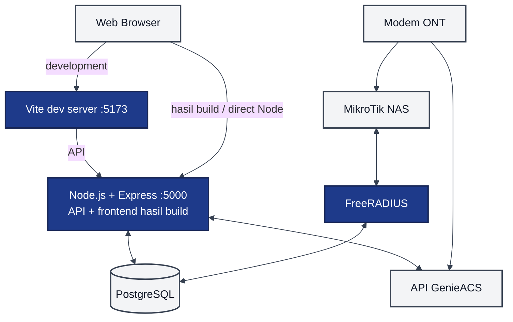
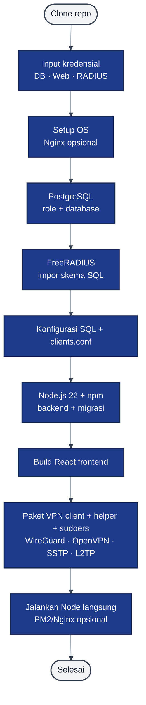

# RANIAH.NET ISP Billing System

<div align="center">

[](https://github.com/oriza23/billing)

**Repositori resmi:** **[https://github.com/oriza23/billing](https://github.com/oriza23/billing)**


### Sistem All-in-One terpusat untuk manajemen ISP mandiri

**Node.js** · **React** · **PostgreSQL** · **FreeRADIUS** · **GenieACS (TR-069)**

Billing pelanggan · RADIUS **PPPoE & Hotspot** · ACS provisioning ONT **Fiberhome / ZTE** · integrasi **MikroTik** NAS.

</div>

---

## Tentang proyek

**RANIAH.NET ISP Billing System (Utama)** adalah panel operasional ISP dalam satu tempat: tagihan dan CRM, autentikasi pelanggan lewat **FreeRADIUS**, serta manajemen modem lewat **GenieACS**. Frontend memakai **React** (Vite), backend memakai **Node.js + Express** (`server.js` dan folder `backend/`), dan **PostgreSQL** adalah database runtime untuk billing dan tabel RADIUS. MariaDB tidak diperlukan untuk menjalankan aplikasi.

Saat development, backend dapat dijalankan langsung dengan Node.js di port **5000** dan frontend Vite secara opsional di port **5173**. Hasil build frontend (`frontend/dist`) juga dapat disajikan langsung oleh Express. Skrip **`install.sh`** mengikuti mode Node langsung secara default; **PM2** dan **Nginx** hanya dipasang bila diaktifkan untuk deployment produksi.

---

## Daftar isi

- [Preview antarmuka](#preview-antarmuka)
- [Diagram arsitektur](#diagram-arsitektur--aliran-data)
- [Struktur proyek](#struktur-proyek)
- [Pengembangan lokal](#pengembangan-lokal-nodejs-langsung)
- [Diagram alur installer](#diagram-alur-installer-installsh)
- [Deployment server](#deployment-server)
- [Input install.sh](#input-yang-diminta-installsh)
- [Kebutuhan sistem & pasca-instalasi](#kebutuhan-sistem--pasca-instalasi)
- [Panduan MikroTik NAS via VPN CHR](#panduan-konfigurasi-mikrotik-nas-router-klien)
- [Dokumentasi lanjutan](#dokumentasi-lanjutan)

---

## Preview antarmuka

Letakkan tangkapan layar di **`assets/images/`** agar GitHub menampilkannya.

| Layar | Berkas |
|-------|--------|
| Dashboard utama | `assets/images/dashboard.png` |
| Manajemen ACS & ONT | `assets/images/acs-panel.png` |
| Hotspot & RADIUS | `assets/images/hotspot.png` |
| PPPoE & langganan | `assets/images/pppoe.png` |


---

## Diagram arsitektur & aliran data



---

## Struktur proyek

```text
.
├── server.js                 # Entry point API Express dan server frontend
├── database.js               # Koneksi PostgreSQL
├── backend/
│   ├── routes/               # Endpoint API
│   ├── middleware/           # Autentikasi dan otorisasi
│   ├── pppoe_isolir/         # Isolir PPPoE
│   └── ...                   # Modul ACS, pelanggan, RADIUS, dan lainnya
├── frontend/
│   ├── src/                  # Aplikasi React
│   ├── public/               # Aset statis
│   └── dist/                 # Hasil build, dibuat oleh Vite
├── utils/                    # Utilitas backend dan cron
├── scripts/                  # Setup admin, migrasi, dan administrasi
├── docs/                     # Dokumentasi teknis
├── deploy/freeradius/        # Konfigurasi dan panduan FreeRADIUS
├── test/                     # Tes Node.js
├── assets/images/            # Gambar dokumentasi
├── uploads/                  # File runtime yang diunggah
├── .env.example              # Contoh konfigurasi backend
├── package.json              # Dependensi dan perintah backend
└── install.sh                # Installer deployment server
```

`frontend/dist` adalah hasil generate dan tidak perlu diedit langsung. `backend/pg_compat.js` menerjemahkan sebagian sintaks query lama ke PostgreSQL; file ini tidak membuat koneksi ke MariaDB. Skrip dan dokumentasi migrasi MariaDB hanya untuk sistem legacy.

---

## Pengembangan lokal (Node.js langsung)

Gunakan **Node.js 22.x** dan **npm 12.x**. Pastikan PostgreSQL sudah berjalan dan siapkan database/role sesuai variabel di `.env`.

### Disarankan di server dev: satu perintah systemd (backend + Vite)

Backend **5000** dan UI Vite **5173** dijalankan bersama; start/stop/restart cukup sekali:

```bash
sudo deploy/install-dev-service.sh   # sekali
sudo systemctl restart billing       # start / stop / restart harian
```

| Aksi | Perintah |
|------|----------|
| Mulai | `sudo systemctl start billing` |
| Berhenti | `sudo systemctl stop billing` |
| Restart (setelah ubah kode) | `sudo systemctl restart billing` |
| Log | `journalctl -u billing -f` |

Buka UI di `http://<IP>:5173`. Jangan jalankan `node server.js` atau `npm run dev` bersamaan dengan service ini (port bentrok).

Panduan untuk developer dan agen AI: **[docs/DEV-RUNTIME.md](docs/DEV-RUNTIME.md)** · aturan Cursor: `.cursor/rules/billing-dev-runtime.mdc`.

### Alternatif: dua terminal manual

```bash
cp .env.example .env
npm install && npm start              # terminal 1 — :5000
cd frontend && npm install && npm run dev -- --host   # terminal 2 — :5173
```

Backend berjalan di `http://localhost:5000`. Bila `frontend/dist/index.html` ada, Express juga bisa menyajikan build pada port yang sama tanpa Vite.

Buka `http://localhost:5173` untuk hot reload. Port `5173` jangan dibuka ke publik (UFW tidak membukanya).

Untuk build frontend dan menyajikannya melalui Node:

```bash
cd frontend
npm run build
cd ..
npm start
```

Mode langsung ini cocok untuk development. Node melayani HTTP pada port `5000`; HTTPS, domain, dan pengelolaan proses saat production perlu dikonfigurasi terpisah.

---

## Diagram alur installer (`install.sh`)



---

## Deployment server

### Prasyarat

- **OS:** Debian 11 atau Ubuntu 22.04 LTS ke atas.
- **Node.js:** 22.x.
- PostgreSQL dan akses root/sudo untuk installer.
- Koneksi internet dan port layanan yang dibutuhkan tidak bentrok.

### Perintah (repositori resmi)

Clone dari **[github.com/oriza23/billing](https://github.com/oriza23/billing)**:

```bash
sudo mkdir -p /var/www
cd /var/www
sudo git clone https://github.com/oriza23/billing.git billing
cd billing
chmod +x install.sh scripts/setup-admin.js
```

> `git clone` memakai URL `.../billing.git` (format standar Git). Halaman repo di browser: **https://github.com/oriza23/billing**

### Instalasi server (default Node langsung)

Secara default installer menyiapkan PostgreSQL, FreeRADIUS, Node.js 22.x, npm 12.x, dependensi backend/frontend, build React, serta paket VPN client untuk menu Koneksi VPN (`wireguard-tools`, `openvpn`, `sstp-client`, `xl2tpd`, `ppp`, dan `strongswan-swanctl` + `charon-systemd` untuk L2TP/IPsec) beserta helper root dan sudoers-nya. PM2 dan Nginx tidak dipasang; setelah instalasi selesai, jalankan backend secara manual:

```bash
sudo ./install.sh
cd /var/www/billing
npm start
```

### Deployment produksi dengan PM2 dan Nginx

Aktifkan kedua komponen secara eksplisit:

```bash
sudo USE_PM2=1 USE_NGINX=1 ./install.sh
```

Nginx menjadi reverse proxy pada port 80 dan PM2 menjaga proses backend tetap berjalan. Installer belum mengatur sertifikat TLS; HTTPS memerlukan konfigurasi sertifikat terpisah.

Untuk memakai PM2 tanpa Nginx, jalankan `sudo USE_PM2=1 ./install.sh`. Untuk Node langsung tanpa kedua komponen, gunakan default atau tetapkan `USE_PM2=0 USE_NGINX=0`. Akses langsung menggunakan `http://IP-SERVER:5000`.

### Hardening: service systemd tanpa root

Backend bisa dijalankan sebagai pengguna sistem `billing` lewat unit systemd, sehingga proses web tidak memegang akses root penuh:

```bash
sudo deploy/install-service.sh
```

Skrip memasang `billing.service` (`User=billing`, `Restart=always`, `ProtectSystem=strict`, hanya `uploads/` dan `/etc` yang writable) dan `/etc/sudoers.d/billing` yang hanya mengizinkan restart PostgreSQL/FreeRADIUS, perubahan zona waktu, serta pengelolaan unit VPN tetap (`wg-quick@wg-billing`, `openvpn-client@raniah-vpn`, `raniah-sstp`, `raniah-l2tp`, dan `xl2tpd`) via `sudo -n`, tanpa wildcard. Bila `FREERADIUS_RESTART_ON_SYNC=1` dipakai, `FREERADIUS_SERVICE` harus tetap `freeradius` agar cocok dengan sudoers.

Catatan keamanan tambahan:

- `CORS_ORIGINS` (lihat `.env.example`) membatasi origin API; kosongkan hanya bila memang perlu akses lintas origin dari mana saja.
- `server.js` mengirim header `Content-Security-Policy`, `X-Frame-Options`, `X-Content-Type-Options`, `Referrer-Policy`, `Permissions-Policy`, dan HSTS saat lewat HTTPS.
- fail2ban (jail `sshd`) melindungi SSH yang masih memakai login root/password.
- Panel saat ini masih tahap pengembangan dan diakses lewat HTTP; HSTS baru berlaku setelah dipasang reverse proxy TLS.
- Port GenieACS (3000/7547/7567) sudah dibuka di UFW **secara sengaja** sebagai persiapan (lihat [Firewall (UFW)](#firewall-ufw)); layanan ACS menyusul, jadi port itu wajar belum ada yang listen.
- `/api/system/health` berada di belakang `requireAuth`, sehingga monitoring eksternal perlu token JWT.
- Untuk monitoring tanpa JWT tersedia `GET /healthz`: publik, hanya membalas `{ status: "ok" }` (200) atau `{ status: "degraded" }` (503) tanpa detail internal. Set `HEALTH_TOKEN` dan kirim header `X-Health-Token` bila ingin detail database/RADIUS (latensi, state layanan).


### Verifikasi

```bash
sudo systemctl status postgresql freeradius --no-pager
# Jika USE_NGINX=1:
sudo systemctl status nginx --no-pager
# Jika USE_PM2=1:
pm2 ls
curl -s -o /dev/null -w "HTTP %{http_code}\n" http://127.0.0.1:5000/
```

---

## Input yang diminta `install.sh`

| Prompt | Variabel | Default | Catatan |
|--------|----------|---------|---------|
| Nama Database | `DB_NAME` | `orizabil` | PostgreSQL billing + RADIUS |
| Username DB | `DB_USER` | `oriza` | Role PostgreSQL |
| Password DB | `DB_PASS` | acak | Enter = otomatis |
| Username Web Admin | `WEB_ADMIN` | `admin` | Login panel |
| Password Web Admin | `WEB_PASS` | — | **Wajib**, min. 8 karakter |
| RADIUS Secret | `RADIUS_SECRET` | acak | Secret MikroTik ↔ FreeRADIUS |
| Nama lengkap admin | — | = WEB_ADMIN | Profil superadmin |
| Domain/IP reverse proxy | `server_name` | `_` | Hanya jika `USE_NGINX=1` |
| Lanjut? | — | `N` | Ketik `y` untuk melanjutkan |

Variabel lingkungan opsional (tanpa prompt): `APP_PORT`, `USE_NGINX`, `USE_PM2`, `GENIEACS_UI_PORT`, `GENIEACS_CWMP_PORT`, `GENIEACS_FS_PORT`, `GENIEACS_OPEN_NBI`, dan `VPN_SUBNET` (subnet tunnel VPN untuk aturan UFW, default `10.210.0.0/24`, kosongkan untuk melewati; harus CIDR IPv4 prefix `/16`–`/32`), mis. `sudo VPN_SUBNET=10.99.0.0/24 ./install.sh`.

---

## Kebutuhan sistem & pasca-instalasi

### Spesifikasi minimum

| Aspek | Minimum | Disarankan |
|--------|---------|------------|
| OS | Debian 11 / Ubuntu 22.04 | LTS terbaru |
| CPU | 2 vCPU | 4 vCPU |
| RAM | 2 GB | 4–8 GB |
| Disk | 20 GB SSD | 40 GB+ SSD |

**Dependensi (via installer):** PostgreSQL, FreeRADIUS + modul PostgreSQL, Node.js **22.x**, npm **12.x**, dan UFW. PM2/Nginx hanya dipasang jika `USE_PM2=1` / `USE_NGINX=1`.

### Port layanan

| Port | Layanan |
|------|---------|
| 5000/tcp | Node.js + Express (API dan frontend build) |
| 5173/tcp | Vite development saja; jangan dibuka ke publik |
| 80/tcp | Nginx → Node.js, jika `USE_NGINX=1` |
| 443/tcp | HTTPS setelah sertifikat dan konfigurasi TLS disiapkan terpisah |
| 5432/tcp | PostgreSQL (localhost) |
| 1812/1813 UDP | FreeRADIUS |
| 7547, 7567, 3000/tcp | GenieACS (jika di host yang sama) |

### Firewall (UFW)

Server ini adalah VPN **client** ke MikroTik CHR, sehingga **tidak ada port inbound VPN** yang dibuka (1194, 1701, 500/4500, 51820, atau port server SSTP seperti 9921). Koneksi VPN keluar tidak butuh aturan karena kebijakan outgoing `allow`. `install.sh` menyetel UFW ke daftar berikut:

| Aturan | Keterangan |
|--------|------------|
| `OpenSSH` (22/tcp) | Dibuka sebelum `ufw enable` agar sesi SSH tidak terputus |
| `5000/tcp` | Billing web (`APP_PORT`) |
| `80/tcp`, `443/tcp` | Hanya bila `USE_NGINX=1` |
| `1812/udp`, `1813/udp` | FreeRADIUS auth dan acct |
| `7547/tcp`, `7567/tcp`, `3000/tcp` | GenieACS CWMP, File Server, UI (persiapan; port NBI 7557 tertutup kecuali `GENIEACS_OPEN_NBI=1`) |
| `from <VPN_SUBNET>` | Semua port dari subnet tunnel VPN (default `10.210.0.0/24`) |

Kebijakan bawaan: `deny incoming`, `allow outgoing`. Installer hanya menambah aturan dan tidak menghapus aturan yang sudah ada. Pada server lama, hapus sisa uji coba secara manual, mis. `sudo ufw delete allow 1194/udp`, lalu cek `sudo ufw status numbered`.

### Pasca-instalasi

1. Buka **`http://IP-SERVER/`** bila memakai Nginx, atau **`http://IP-SERVER:5000/`** bila Node diakses langsung; login superadmin.
2. Isi router MikroTik, profil PPPoE/Hotspot, server GenieACS (`127.0.0.1:7557` untuk NBI lokal).
3. Jika memakai installer, cek proses dengan `pm2 ls`. Pada development, jalankan `npm start` di terminal.
4. Backup rutin `pg_dump` dan file `.env`.

### Koneksi VPN ke MikroTik CHR (Sistem → Koneksi VPN)

Server billing dapat menjadi VPN client ke MikroTik CHR (ROS v7) lewat **WireGuard**, **OpenVPN**, **SSTP**, atau **L2TP** (murni atau L2TP/IPsec). Satu protokol aktif pada satu waktu. Installer memasang `wireguard-tools`, `openvpn`, `sstp-client`, `xl2tpd`, dan `ppp`, serta `strongswan-swanctl` + `charon-systemd` (opsional, hanya dipakai bila IPsec Pre-Shared Key diisi). `xl2tpd` dan strongSwan dimatikan setelah dipasang dan baru dinyalakan oleh `raniah-l2tp.service` saat L2TP dihubungkan, sehingga port UDP 1701/500/4500 tidak terbuka selama L2TP tidak dipakai. Pada server yang sudah terpasang, pasang paket manual dengan `sudo apt install -y xl2tpd ppp strongswan-swanctl charon-systemd`, lalu jalankan `sudo ./install.sh` atau `sudo deploy/install-service.sh` untuk memperbarui sudoers dan helper.

| Protokol | Interface | Kebutuhan OS |
|----------|-----------|--------------|
| WireGuard | `wg-billing` | Modul kernel `wireguard` (tidak butuh device tambahan) |
| OpenVPN | `raniah-ovpn` | `/dev/net/tun` |
| SSTP | `raniah-sstp` | `/dev/ppp` (di LXC: modul `ppp_async` dan kontainer Privileged) |
| L2TP | `raniah-l2tp` | `/dev/ppp` (di LXC: sama dengan SSTP). L2TP/IPsec: paket `strongswan-swanctl` + `charon-systemd` |

Kartu **Status Koneksi** menampilkan RX/TX real-time (dari `/sys/class/net/<iface>/statistics`) serta dua ping dinamis: ke endpoint publik CHR dan ke gateway tunnel (`.1`). Semuanya berlaku sama untuk keempat protokol. Bila koneksi belum tersambung, baris terakhir `journalctl` unit ditampilkan di UI (SSTP dan L2TP: 20 baris; L2TP menggabungkan log `raniah-l2tp` dan `xl2tpd`) beserta dugaan penyebabnya (sertifikat, port, atau kredensial). Restart backend dengan `systemctl restart billing`, bukan `node server.js` manual.

#### Tuning performa dan stabilitas VPN

Generator konfigurasi memakai nilai bawaan yang meminimalkan latensi dan fragmentasi untuk trafik RADIUS lewat jalur PPPoE. Konfigurasi dibuat ulang setiap kali **Hubungkan**, jadi profil yang sudah tersimpan ikut memakai nilai ini pada koneksi berikutnya.

| Protokol | Nilai bawaan | Keterangan |
|----------|--------------|------------|
| WireGuard | `MTU = 1380`, `PersistentKeepalive = 15` | Isi MTU/Keepalive manual di form untuk menimpa. Profil yang menyimpan keepalive `25` tetap memakai `25` sampai diubah. |
| OpenVPN | `tun-mtu 1400`, `mssfix 1360`, `sndbuf 393216`, `rcvbuf 393216`, `fast-io` (hanya bila semua remote UDP), `data-ciphers AES-256-GCM:AES-128-GCM`, `tls-version-min 1.2` | Hanya ditambahkan bila belum ada di `.ovpn` (nilai di `.ovpn` tidak ditimpa). Bila `.ovpn` sudah memilih `cipher`/`data-ciphers`, pilihan itu dihormati agar profil CHR lama tidak putus. `tls-version-min` di bawah 1.2 selalu dinaikkan ke 1.2. |
| SSTP dan L2TP | `mtu 1400`, `mru 1400`, `lcp-echo-interval 5`, `lcp-echo-failure 3`, `RestartSec=3` | Link mati terdeteksi dalam 15 detik, lalu systemd menyambung ulang 3 detik kemudian. |

`install.sh` menulis `/etc/sysctl.d/99-raniah-vpn.conf` lalu menjalankan `sysctl --system`:

```ini
net.core.rmem_max=26214400
net.core.wmem_max=26214400
net.ipv4.udp_rmem_min=16384
net.ipv4.udp_wmem_min=16384
net.ipv4.tcp_mtu_probing=1
net.ipv4.conf.all.rp_filter=2
```

Buffer `rmem_max`/`wmem_max` harus lebih besar dari `sndbuf`/`rcvbuf` OpenVPN agar kernel tidak memotongnya diam-diam. Di kontainer LXC sebagian parameter `net.core.*` read-only. Installer tidak gagal; ia menerapkan parameter satu per satu dan menampilkan peringatan untuk yang ditolak. Berkasnya tetap tersimpan, dan parameter itu bisa diset di **host Proxmox** (`/etc/sysctl.d/` di host). Untuk server yang sudah terpasang, jalankan ulang `sudo ./install.sh`, atau salin berkas di atas ke `/etc/sysctl.d/99-raniah-vpn.conf` lalu `sudo sysctl --system`.

#### Konfigurasi L2TP

Form L2TP berisi **Server CHR** (default UDP 1701), **Username** dan **Password** (PPP secret di CHR), **Subnet Route NAS** (opsional), dan **IPsec Pre-Shared Key** (opsional).

- **IPsec Pre-Shared Key kosong:** L2TP murni, tanpa enkripsi IPsec.
- **IPsec Pre-Shared Key terisi:** L2TP/IPsec (IKEv1, transport mode UDP 1701) lewat strongSwan `swanctl`. Konfigurasi ditulis ke `/etc/swanctl/conf.d/raniah-l2tp.conf`. Bila paket `strongswan-swanctl` belum terpasang, **Hubungkan** ditolak dengan pesan perintah `apt install`.
- **Subnet Route NAS:** rute statis lewat hook `/etc/ppp/ip-up.d/raniah-l2tp` ke interface `raniah-l2tp`. Default gateway server tidak diubah dan DNS lokal tidak ditimpa (`usepeerdns` tidak dipakai).

File yang ditulis helper root: `/etc/xl2tpd/xl2tpd.conf` (section `[lac raniah-l2tp]`; konfigurasi bawaan dicadangkan ke `xl2tpd.conf.pre-raniah`), `/etc/ppp/options.l2tpd.client`, `/etc/xl2tpd/raniah-l2tp-run.sh`, dan `/etc/systemd/system/raniah-l2tp.service`. Unit memakai `Restart=always` dan `RestartSec=3`, sehingga tersambung ulang otomatis saat putus maupun setelah reboot. Saat L2TP dihubungkan, unit protokol lain dimatikan (`disable --now` + `reset-failed`), dan sebaliknya `raniah-l2tp` serta `xl2tpd` dimatikan saat protokol lain dipilih.

Di CHR (ROS v7), aktifkan L2TP server dan buat PPP secret:

```routeros
/ppp profile add name=raniah-l2tp local-address=10.210.0.1 remote-address=<pool-vpn> use-encryption=yes
/ppp secret add name=billing password=<password> service=l2tp profile=raniah-l2tp remote-address=10.210.0.2
# L2TP murni:
/interface l2tp-server server set enabled=yes default-profile=raniah-l2tp use-ipsec=no
# L2TP/IPsec (isi ipsec-secret sama dengan IPsec Pre-Shared Key di form; "required" menolak koneksi tanpa IPsec):
/interface l2tp-server server set enabled=yes default-profile=raniah-l2tp use-ipsec=required ipsec-secret=<psk>
```

Buka di firewall input CHR: `udp/1701` (L2TP), serta `udp/500`, `udp/4500`, dan protokol `ipsec-esp` bila memakai IPsec.

#### Catatan Pengguna Proxmox LXC

Di server fisik dan VPS, `/dev/ppp` dan `/dev/net/tun` biasanya sudah ada. Di kontainer LXC Proxmox keduanya tidak ada sampai diteruskan dari host. Perintah di bawah dijalankan di **host Proxmox**, kecuali verifikasi `ls` yang dijalankan di dalam kontainer. Ganti `<CTID>` dengan ID kontainer (`pct list`).

| Protokol | Unprivileged | Privileged | Yang wajib di host |
|----------|--------------|------------|--------------------|
| WireGuard | Langsung jalan | Langsung jalan | Tidak ada device tambahan |
| OpenVPN | Jalan | Jalan | Passthrough `/dev/net/tun` |
| SSTP | Tidak cukup | Wajib (`unprivileged: 0`) | Modul `ppp_generic` + `ppp_async`, dan passthrough `/dev/ppp` |
| L2TP | Tidak cukup | Wajib (`unprivileged: 0`) | Sama dengan SSTP: modul `ppp_generic` + `ppp_async`, dan passthrough `/dev/ppp` |

Tanpa kontainer Privileged, SSTP dan L2TP tetap gagal meskipun `/dev/ppp` sudah ada: `pppd: Couldn't set tty to PPP discipline: Operation not permitted`.

**Langkah 1 — Modul PPP permanen di host**

```bash
modprobe ppp_generic
modprobe ppp_async
printf "ppp_generic\nppp_async\n" > /etc/modules-load.d/ppp.conf
chmod 666 /dev/ppp
```

**Langkah 2 — Passthrough device di `/etc/pve/lxc/<CTID>.conf`**

```ini
# Untuk SSTP dan L2TP (/dev/ppp)
lxc.cgroup2.devices.allow: c 108:0 rwm
lxc.mount.entry: /dev/ppp dev/ppp none bind,create=file

# Untuk OpenVPN (/dev/net/tun)
lxc.cgroup2.devices.allow: c 10:200 rwm
lxc.mount.entry: /dev/net/tun dev/net/tun none bind,create=file
```

**Langkah 3 — Kontainer Privileged (khusus SSTP dan L2TP)**

SSTP dan L2TP butuh kontainer **Privileged** karena keduanya memakai `pppd`. OpenVPN dan WireGuard tidak. Jika kontainer dibuat sebagai Unprivileged, Proxmox tidak mengizinkan mengganti tipe itu pada kontainer yang sedang berjalan. Buat ulang lewat **Backup & Restore**: backup kontainer, restore, dan hilangkan centang **Unprivileged container**. Hasilnya `unprivileged: 0` di `/etc/pve/lxc/<CTID>.conf`.

**Langkah 4 — Restart dan verifikasi**

Di host:

```bash
pct reboot <CTID>
```

Di dalam kontainer, setelah kontainer naik:

```bash
ls -l /dev/ppp /dev/net/tun
```

Keduanya harus tampil sebagai character device. Menu **Sistem → Koneksi VPN** menampilkan peringatan kuning dan menolak menghubungkan bila device yang dibutuhkan belum ada.

`install.sh` mendeteksi kontainer (`systemd-detect-virt -c`) dan menampilkan ringkasan ini di akhir instalasi, tanpa menggagalkan instalasi.

### Panduan Konfigurasi MikroTik NAS (Router Klien)

Panduan ini mengasumsikan topologi **hub-and-spoke**: **MikroTik CHR** sebagai VPN hub, **server billing** sebagai client VPN ke CHR, dan setiap **MikroTik NAS** (router di lapangan) juga sebagai client VPN ke CHR yang sama. Lalu NAS mengirim autentikasi RADIUS ke billing lewat **IP VPN** (bukan IP publik WAN). Contoh subnet tunnel di bawah memakai `10.210.0.0/24`; sesuaikan dengan pool CHR Anda.

| Peran | Contoh fungsi |
|-------|----------------|
| CHR (hub) | SSTP/L2TP/WireGuard server, routing antar peer VPN |
| Server billing | Client VPN + FreeRADIUS (menu **Sistem → Koneksi VPN**) |
| MikroTik NAS | Client VPN + PPPoE/Hotspot; RADIUS client ke billing |

#### 1. Pengaturan di MikroTik CHR (VPN hub)

**Kunci IP statis (penting)** — Agar entri `nas` di FreeRADIUS tidak berubah setiap reconnect, tetapkan alamat VPN **statis** untuk server billing dan tiap NAS:

- **SSTP/L2TP:** di **PPP → Secrets**, set **Remote Address** ke IP tetap dalam pool (mis. billing `10.210.0.2`, NAS-1 `10.210.0.11`, NAS-2 `10.210.0.12`). Jangan mengandalkan dynamic pool saja bila Anda ingin IP RADIUS stabil.
- **WireGuard:** pada **peer** masing-masing client, isi **Allowed Address** dengan **`/32` tunggal** untuk IP client itu (mis. `10.210.0.2/32` untuk billing, `10.210.0.11/32` untuk NAS-1). CHR memerlukan rute host ke tiap peer; subnet penuh biasanya diisi di sisi **NAS** (lihat bagian 2).

**Izinkan trafik antar-VPN (hub-to-spoke)** — Tanpa aturan ini, CHR bisa mem-forward tetapi filter memblokir lalu lintas antar client (NAS tidak bisa ping ke IP VPN billing):

```routeros
/ip firewall filter add chain=forward src-address=10.210.0.0/24 dst-address=10.210.0.0/24 action=accept place-before=0 comment="Allow VPN Hub-to-Spoke"
```

Pastikan juga tidak ada rule `drop` di `forward` yang menangkap trafik antar subnet VPN sebelum rule di atas. Sesuaikan `src-address`/`dst-address` bila pool Anda berbeda.

#### 2. Routing VPN di MikroTik NAS (router klien)

NAS harus bisa mencapai **IP VPN server billing** sebelum RADIUS berfungsi.

**Jika NAS memakai SSTP client** — Tambahkan rute statis ke subnet VPN agar trafik ke billing tidak keluar lewat default gateway WAN (gejala umum: `net unreachable` saat ping/RADIUS):

```routeros
/ip route add dst-address=10.210.0.0/24 gateway=sstp-out1 comment="Route ke VPN Billing"
```

Ganti `sstp-out1` dengan nama interface SSTP client Anda (`/interface sstp-client print`). Opsional: rute host saja ke billing, mis. `dst-address=10.210.0.2 gateway=sstp-out1`.

**Jika NAS memakai WireGuard client** — Pada **peer** menuju CHR, isi **Allowed Address** dengan **subnet penuh** tunnel (mis. `10.210.0.0/24`), bukan hanya `/32` lokal NAS. Dengan begitu kernel NAS memasang rute ke seluruh peer di VPN, termasuk IP billing.

**Verifikasi** — Dari terminal NAS:

```routeros
/ping 10.210.0.2 count=5
```

Ganti `10.210.0.2` dengan `<IP_VPN_BILLING>`. Harus ada reply. Jika timeout, perbaiki VPN, firewall CHR, dan rute di langkah 1–2 sebelum melanjutkan ke RADIUS.

#### 3. Konfigurasi RADIUS client di MikroTik NAS (RouterOS v7)

Ganti placeholder berikut:

| Placeholder | Arti |
|-------------|------|
| `<IP_VPN_BILLING>` | IP VPN server billing (contoh `10.210.0.2`) |
| `<IP_VPN_NAS>` | IP VPN NAS ini (contoh `10.210.0.11`); dipakai sebagai **src-address** agar RADIUS keluar dari tunnel |
| `<RADIUS_SECRET>` | Secret sama dengan di web billing / `RADIUS_SECRET` install |

**Tambahkan server RADIUS:**

```routeros
/radius add service=ppp,hotspot address=<IP_VPN_BILLING> secret=<RADIUS_SECRET> src-address=<IP_VPN_NAS> timeout=3s comment="RANIAH.NET Billing"
```

**Aktifkan RADIUS Incoming (CoA / Disconnect)** — Diperlukan agar isolir, buka isolir, dan putus sesi dari web billing berfungsi:

```routeros
/radius incoming set accept=yes port=3799
```

Buka **UDP 3799** pada firewall NAS bila ada filter yang memblokir dari arah server billing.

**Autentikasi RADIUS untuk PPPoE dan Hotspot:**

```routeros
/ppp aaa set use-radius=yes accounting=yes
/ip hotspot profile set [find default=no] use-radius=yes
```

Profil Hotspot yang dipakai pelanggan harus memakai profil dengan `use-radius=yes`. Untuk PPPoE, pastikan **PPP → Secrets** / profil mengandalkan RADIUS (bukan local only).

#### 4. Daftarkan router di web billing

1. Login panel → menu **Router** (Manajemen Router).
2. **Tambah Server** dengan **IP** = `<IP_VPN_NAS>` (bukan IP WAN publik).
3. **RADIUS Secret** = `<RADIUS_SECRET>` yang sama persis dengan baris `/radius` di NAS.
4. Pilih jenis **Hotspot** dan/atau **PPPoE** sesuai layanan di NAS; pastikan **Nama Server** (mis. nama server PPPoE/Hotspot di Winbox) cocok dengan yang dipakai voucher/langganan di billing.

Setelah disimpan, aplikasi menyinkronkan router ke tabel `nas` FreeRADIUS. Bila perlu, restart FreeRADIUS: `sudo systemctl restart freeradius`. Detail banyak NAS: [`docs/MULTI_NAS.md`](docs/MULTI_NAS.md). Detail isolir/CoA: [`docs/PPPOE_ISOLIR.md`](docs/PPPOE_ISOLIR.md).

### Winbox — MikroTik → RADIUS (ringkas, tanpa VPN)

Bila billing dan NAS satu jaringan LAN (tanpa CHR), konfigurasi Winbox setara dengan langkah 3 di atas:

1. **Radius** → **+**
2. **Address:** IP server billing (LAN)
3. **Secret:** sama dengan **RADIUS_SECRET** saat `install.sh`
4. **Auth:** `1812` · **Acct:** `1813` · centang **ppp** / **hotspot**
5. Aktifkan **accounting** untuk pelaporan sesi.

Untuk topologi VPN hub-and-spoke, ikuti [Panduan Konfigurasi MikroTik NAS (Router Klien)](#panduan-konfigurasi-mikrotik-nas-router-klien) di atas.

---

## Dokumentasi lanjutan

| Dokumen | Isi |
|---------|-----|
| [`docs/DATABASE-POSTGRESQL.md`](docs/DATABASE-POSTGRESQL.md) | PostgreSQL & variabel lingkungan |
| [`docs/MIGRASI-MARIADB-KE-POSTGRESQL.md`](docs/MIGRASI-MARIADB-KE-POSTGRESQL.md) | Migrasi legacy |
| [`deploy/freeradius/README.md`](deploy/freeradius/README.md) | Modul FreeRADIUS |

---

<div align="center">

**RANIAH.NET** · [github.com/oriza23/billing](https://github.com/oriza23/billing)

</div>