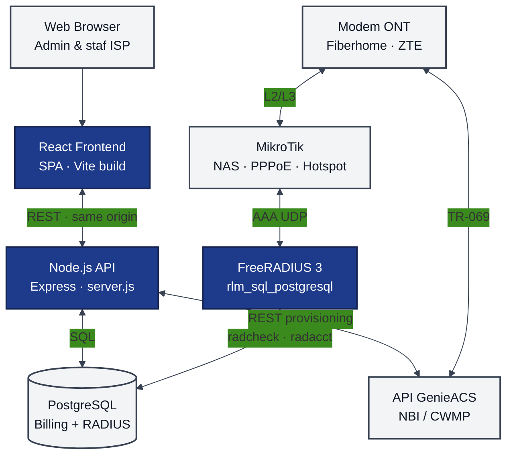
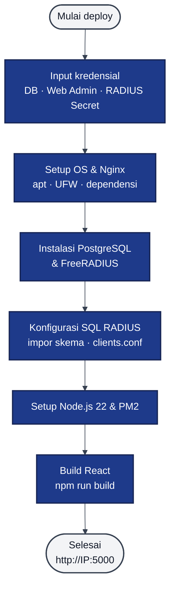

# RANIAH.NET — ISP Billing System (Utama)

<div align="center">

### Sistem All-in-One terpusat untuk manajemen ISP mandiri

Dibangun dengan **Node.js** dan **React** — mengelola **billing pelanggan**, autentikasi **FreeRADIUS** (PPPoE & Hotspot), dan provisioning **ACS TR-069** (GenieACS) untuk ONT **Fiberhome / ZTE**, dengan **MikroTik** sebagai NAS.

**Satu panel web · satu database PostgreSQL · dari tagihan hingga sesi di router dan parameter di modem.**

</div>

---

## Daftar isi

- [Preview antarmuka](#preview-antarmuka)
- [Diagram arsitektur & aliran data](#diagram-arsitektur--aliran-data)
- [Diagram alur instalasi otomatis](#diagram-alur-instalasi-otomatis)
- [Panduan instalasi](#panduan-instalasi-step-by-step)
- [Input yang diminta install.sh](#input-yang-diminta-installsh)
- [Kebutuhan sistem & pasca-instalasi](#kebutuhan-sistem--pasca-instalasi)
- [Dokumentasi lanjutan](#dokumentasi-lanjutan)

---

## Preview antarmuka

Tambahkan tangkapan layar aplikasi ke folder **`assets/images/`** (format PNG atau WebP, lebar disarankan 1280px) agar pratinjau tampil di GitHub.

| Pratinjau | File |
|-----------|------|
| Dashboard & ringkasan operasional | `assets/images/dashboard.png` |
| Manajemen ACS & inventaris ONT | `assets/images/acs-panel.png` |
| Hotspot, voucher & integrasi RADIUS | `assets/images/hotspot.png` |


*Gambar 1 — Dashboard utama RANIAH.NET (letakkan berkas `dashboard.png` di `assets/images/`).*


*Gambar 2 — Panel ACS: sinkron GenieACS, WiFi/LAN/WAN ONU (`acs-panel.png`).*


*Gambar 3 — Manajemen profil hotspot, voucher, dan kaitan ke FreeRADIUS (`hotspot.png`).*

> **Tips untuk maintainer repo:** setelah screenshot siap, commit ketiga file di atas. GitHub akan merender gambar secara otomatis. Nama file harus persis seperti placeholder agar link tidak putus.

---

## Diagram arsitektur & aliran data

Aliran data **top-down** antara operator, aplikasi billing, database, ACS, RADIUS, NAS, dan CPE pelanggan.

| Kelas warna | Hex | Pemakaian |
|-------------|-----|-----------|
| Aplikasi inti | `#1e3a8a` | React, Node.js API, FreeRADIUS |
| Eksternal / data | `#f3f4f6` + tepi `#374151` | Browser, PostgreSQL, GenieACS, MikroTik, ONT |
| Latar diagram | `#ffffff` | Latar putih (identitas visual RANIAH.NET) |



---

## Diagram alur instalasi otomatis

Urutan kerja **`install.sh`** pada server fresh (Debian 11 / Ubuntu 22.04+).

> **Catatan:** pada deploy **billing utama**, web dilayani langsung oleh **Node.js** (port **5000**); installer **tidak memasang Nginx**. Node *Setup OS & Nginx* di diagram mengikuti alur dokumen standar—langkah OS & dependensi pada skrip hanya memasang paket dasar, PostgreSQL, FreeRADIUS, Node, dan PM2.



---

## Panduan instalasi (step-by-step)

### Prasyarat

- **Debian 11** atau **Ubuntu 22.04** LTS (atau turunan Ubuntu yang Anda uji).
- Akses **root** / **sudo**.
- Git terpasang di server.

### Perintah copy-paste

Ganti URL `git clone` dengan repositori GitHub **RANIAH.NET** Anda.

```bash
sudo mkdir -p /var/www
cd /var/www

# Clone repositori (sesuaikan URL)
sudo git clone https://github.com/ORGANISASI-ANDA/raniah-billing.git billing
cd billing

# Izin eksekusi installer
sudo chmod +x install.sh scripts/setup-admin.js

# Instalasi interaktif penuh stack billing
sudo ./install.sh
```

### Verifikasi singkat

```bash
sudo systemctl is-active postgresql freeradius
pm2 ls
curl -s -o /dev/null -w "HTTP %{http_code}\n" http://127.0.0.1:5000/
```

Buka browser: **`http://<IP-SERVER>:5000`** — login dengan user superadmin dari instalasi.

### Opsi environment

```bash
sudo APP_PORT=5000 ./install.sh          # port web (default 5000)
# sudo GENIEACS_OPEN_NBI=1 ./install.sh  # buka 7557 — hanya jika Anda paham risikonya
```

---

## Input yang diminta `install.sh`

| Pertanyaan installer | Default | Keterangan |
|----------------------|---------|------------|
| **Nama DB** (`DB_NAME`) | `orizabil` | Database PostgreSQL billing + RADIUS |
| **User DB** (`DB_USER`) | `oriza` | Role PostgreSQL |
| **Password DB** (`DB_PASS`) | otomatis | Kosongkan Enter = password acak |
| **Web Admin** (`WEB_ADMIN`) | `admin` | Username login panel |
| **Password Web Admin** (`WEB_PASS`) | — | **Wajib**, minimal 8 karakter |
| **RADIUS Secret** (`RADIUS_SECRET`) | otomatis | Secret NAS MikroTik ↔ FreeRADIUS |
| Nama lengkap admin | = Web Admin | Profil superadmin awal |
| Konfirmasi lanjut | `N` | Ketik **`y`** untuk melanjutkan |

Skrip juga menghasilkan **`JWT_SECRET`**, menulis **`.env`** (`DB_SERVICE=postgresql`), mengimpor skema RADIUS, mendaftarkan client **`0.0.0.0/0`**, menjalankan migrasi skema aplikasi, **`setup-admin.js`**, dan **`pm2 start`** proses `billing`.

Kredensial: **`/var/www/billing/.env`** — jangan di-commit.

---

## Kebutuhan sistem & pasca-instalasi

### Spesifikasi server

| Aspek | Minimum | Produksi (perkiraan) |
|--------|---------|----------------------|
| **OS** | Debian 11 / Ubuntu 22.04 | LTS yang didukung tim Anda |
| **CPU** | 2 vCPU | 4 vCPU |
| **RAM** | 2 GB | 4–8 GB *(+ GenieACS di host yang sama)* |
| **Disk** | 20 GB SSD | 40 GB+ SSD |

**Stack yang dipasang `install.sh`:** PostgreSQL, FreeRADIUS (`freeradius-postgresql`), Node.js **22**, PM2, build frontend React, aturan UFW (SSH, web, RADIUS UDP, port GenieACS).

### Port utama

| Port | Layanan |
|------|---------|
| 5000/tcp | Web billing |
| 5432/tcp | PostgreSQL *(localhost)* |
| 1812/udp, 1813/udp | RADIUS |
| 7547, 7567, 3000/tcp | GenieACS *(bila diinstal bersama)* |
| 7557/tcp | GenieACS NBI *(default hanya localhost)* |

### Pasca-instalasi

1. Login panel → lengkapi profil ISP, router, server ACS (`127.0.0.1:7557` jika GenieACS lokal).
2. `pm2 save` dan jalankan perintah **`pm2 startup`** yang ditampilkan installer.
3. Backup rutin: `pg_dump` + salinan `.env`.
4. HTTPS: gunakan reverse proxy terpisah; set `TRUST_PROXY=1` hanya di belakang proxy tepercaya.

### Konfigurasi Winbox — MikroTik ke RADIUS Server

Gunakan **`IP_SERVER`** (IP VPS billing) dan **`RADIUS_SECRET`** sama persis dengan input instalasi.

#### 1. Tambah server RADIUS

1. **Winbox** → **Radius** → **+**
2. **Services:** centang **ppp**, **hotspot**, **login** (sesuai topologi).
3. **Address:** `IP_SERVER`
4. **Secret:** `RADIUS_SECRET`
5. **Authentication Port:** `1812`
6. **Accounting Port:** `1813`
7. **Timeout:** 3000–5000 ms
8. Aktifkan **accounting** untuk pelacakan sesi di `radacct`.

#### 2. PPPoE & Hotspot memakai RADIUS

- **PPP:** aktifkan penggunaan RADIUS pada pengaturan AAA/PPP server Anda.
- **Hotspot → Server Profile:** **Use RADIUS** = **yes** untuk voucher/profil dari billing.

#### 3. Jaringan

- Pastikan MikroTik mengirim **UDP 1812/1813** ke `IP_SERVER` (buka firewall di VPS jika perlu — UFW installer sudah mengizinkan RADIUS).

#### 4. API RouterOS (fitur billing)

Daftarkan router di panel billing: IP, user API, port **8728**/**8729**. Batasi hak user API seminimal mungkin.

Detail isolir PPPoE: [`docs/PPPOE_ISOLIR.md`](docs/PPPOE_ISOLIR.md).

---

## Dokumentasi lanjutan

| Berkas | Isi |
|--------|-----|
| [`docs/DATABASE-POSTGRESQL.md`](docs/DATABASE-POSTGRESQL.md) | PostgreSQL & `.env` |
| [`docs/MIGRASI-MARIADB-KE-POSTGRESQL.md`](docs/MIGRASI-MARIADB-KE-POSTGRESQL.md) | Migrasi legacy |
| [`deploy/freeradius/README.md`](deploy/freeradius/README.md) | Modul FreeRADIUS |

---

<div align="center">

**RANIAH.NET** · ISP Billing System

*Biru tua · data terpusat · Billing · RADIUS · ACS*

</div>