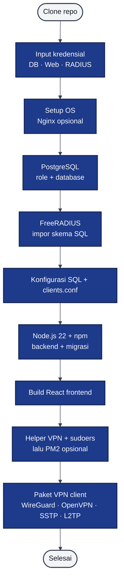

# Instalasi server — `install.sh`

Panduan ini adalah **sumber utama** untuk memasang RANIAH Billing di VPS/server **Ubuntu 22.04 / 24.04** atau **Debian 12 / 13** (atau turunan Debian: `ID_LIKE=debian`; termasuk Proxmox LXC). Ringkasan di [README.md](../README.md#deployment-server) mengacu ke dokumen ini.

Repositori: **[github.com/oriza23/billing](https://github.com/oriza23/billing)** · `git clone https://github.com/oriza23/billing.git`

---

## Diagram alur



---

## Prasyarat

- **OS:** Ubuntu 22.04 / 24.04, Debian 12 / 13 (terdeteksi dari `/etc/os-release`: `ID=ubuntu|debian` atau `ID_LIKE` memuat `debian`).
- **Node.js:** 22.x (dipasang otomatis jika belum ada).
- **`install.sh` mendukung dua mode login:**

| Mode | Siapa | Menjalankan installer | Catatan |
|------|--------|------------------------|---------|
| **Disarankan** | User non-root di grup `sudo` (`ubuntu`, `debian`, admin Anda) | `./install.sh` atau `sudo ./install.sh` | PM2/VPN memakai **TARGET_USER** = user ini (atau `SUDO_USER` bila `sudo ./install.sh`) |
| **Alternatif** | Login `root` langsung | `./install.sh` | Tidak perlu paket `sudo`; hindari menjalankan PM2 sebagai root di produksi |

- Koneksi internet; port tidak bentrok dengan layanan lain.

**Debian (user biasa):** jika `sudo` belum terpasang: `apt install -y sudo`, tambahkan user ke grup `sudo`.

**Setelah instalasi dengan PM2:** helper VPN (`/usr/local/sbin/raniah-vpn-helper`, mode **755**) dan `/etc/sudoers.d/raniah-vpn-helper` dipasang **sebelum** PM2 start, agar menu **Sistem → Koneksi VPN** berjalan tanpa error “Helper VPN belum terpasang”.

---

## Clone repositori

### A) User non-root + `sudo` (disarankan)

**Cara 1** — `sudo git clone`, lalu `sudo chmod`:

```bash
sudo mkdir -p /var/www
cd /var/www
sudo git clone https://github.com/oriza23/billing.git billing
cd billing
sudo chmod +x install.sh scripts/setup-admin.js
```

**Cara 2** — kembalikan kepemilikan ke user Anda:

```bash
sudo mkdir -p /var/www
sudo git clone https://github.com/oriza23/billing.git /var/www/billing
sudo chown -R "$USER:$USER" /var/www/billing
cd /var/www/billing
chmod +x install.sh scripts/setup-admin.js
```

> Clone dengan `sudo` → berkas milik **root**. Tanpa `chown`, `chmod` wajib pakai `sudo`.

### B) Login sebagai `root`

```bash
mkdir -p /var/www
cd /var/www
git clone https://github.com/oriza23/billing.git billing
cd billing
chmod +x install.sh scripts/setup-admin.js
```

---

## Menjalankan installer

### Default (PM2 aktif, tanpa Nginx)

`USE_PM2=1` (default) dan `USE_NGINX=0` (default). Backend dijalankan PM2 dengan nama `billing` sebagai **TARGET_USER**, lengkap dengan auto-start systemd (`pm2-<user>.service`).

| Login | Perintah | TARGET_USER (pemilik proyek + PM2) |
|-------|----------|-------------------------------------|
| User + sudo | `cd /var/www/billing && ./install.sh` | user yang menjalankan |
| User + sudo | `cd /var/www/billing && sudo ./install.sh` | `SUDO_USER` |
| root | `cd /var/www/billing && ./install.sh` | `root` |

```bash
cd /var/www/billing
./install.sh
pm2 ls
```

Installer **idempoten**: aman dijalankan ulang. Bila `.env` sudah ada, `DB_USER`/`DB_PASSWORD`/`DB_NAME`/`DB_PORT` dan superadmin dibaca dari `.env` (tidak ditanya lagi), password role PostgreSQL disinkronkan ke nilai itu, `JWT_SECRET` dipertahankan, dan baris `.env` lain milik Anda tidak dihapus.

Installer menyiapkan antara lain: PostgreSQL, FreeRADIUS, migrasi SQL, build frontend, paket VPN client, UFW, helper VPN, dan sudoers layanan.

### Produksi: PM2 dan/atau Nginx

| Login | Contoh |
|-------|--------|
| User + sudo | `USE_PM2=1 USE_NGINX=1 ./install.sh` atau `sudo env USE_PM2=1 USE_NGINX=1 ./install.sh` |
| root | `USE_PM2=1 USE_NGINX=1 ./install.sh` |

```bash
cd /var/www/billing
USE_PM2=1 USE_NGINX=1 ./install.sh
```

- **PM2 saja:** `USE_PM2=1 ./install.sh`
- **Tanpa PM2 dan Nginx:** `USE_PM2=0 USE_NGINX=0 ./install.sh`, lalu `npm start`
- **Akses langsung:** `http://IP-SERVER:5000` (port default `APP_PORT=5000`)
- TLS/HTTPS belum disetel installer; Nginx hanya reverse proxy port 80 bila `USE_NGINX=1`.

### Alternatif: systemd user `billing` (bukan PM2)

```bash
sudo deploy/install-service.sh
```

Unit `billing.service` menjalankan proses sebagai user sistem `billing` + sudoers terbatas. Detail hardening: [README — Hardening](../README.md#hardening-service-systemd-tanpa-root).

---

## Input interaktif `install.sh`

| Prompt | Variabel | Default | Catatan |
|--------|----------|---------|---------|
| Nama Database | `DB_NAME` | `orizabil` | PostgreSQL billing + RADIUS |
| Username DB | `DB_USER` | `oriza` | Role PostgreSQL |
| Password DB | `DB_PASSWORD` | acak (`openssl rand -hex 16`) | Enter = otomatis. Bila diisi manual: min. 8 karakter dari `A-Z a-z 0-9 . _ @ + = : , ! ~ ^ * / -` |
| Username Web Admin | `WEB_ADMIN` | `admin` | Login panel |
| Password Web Admin | `WEB_PASS` | — | **Wajib**, min. 8 karakter |
| RADIUS Secret | `RADIUS_SECRET` | acak | Secret MikroTik ↔ FreeRADIUS |
| Nama lengkap admin | — | = WEB_ADMIN | Profil superadmin |
| Domain/IP reverse proxy | `server_name` | `_` | Hanya jika `USE_NGINX=1` |
| Lanjut? | — | `N` | Ketik `y` untuk melanjutkan |

### Variabel lingkungan (tanpa prompt)

| Variabel | Arti |
|----------|------|
| `APP_PORT` | Port HTTP backend (default `5000`) |
| `USE_PM2` | `1` (default) = pasang/jalankan PM2 + auto-start; `0` = lewati |
| `USE_NGINX` | `1` = pasang Nginx reverse proxy |
| `GENIEACS_*` | Port GenieACS (UI/CWMP/FS/NBI) |
| `VPN_SUBNET` | Subnet tunnel untuk UFW (default `10.210.0.0/24`; kosong = lewati; CIDR `/16`–`/32`) |

Contoh:

```bash
# user non-root
VPN_SUBNET=10.99.0.0/24 USE_PM2=1 ./install.sh

# atau
sudo env VPN_SUBNET=10.99.0.0/24 USE_PM2=1 ./install.sh
```

Database lebih lanjut: [DATABASE-POSTGRESQL.md](./DATABASE-POSTGRESQL.md).

---

## Verifikasi setelah instalasi

```bash
sudo systemctl status postgresql freeradius --no-pager
# USE_NGINX=1:
sudo systemctl status nginx --no-pager
# USE_PM2=1:
pm2 ls
pm2 logs billing --lines 30
curl -s -o /dev/null -w "HTTP %{http_code}\n" http://127.0.0.1:5000/
```

**FreeRADIUS:** `mods-available/sql` ditulis deterministik oleh `deploy/freeradius/write-sql-mod.js` dari `.env` (bukan `sed`), lalu installer: mengatur izin (`root:freerad` 640; `/var/log/freeradius` dan `/run/freeradius` milik `freerad`), memvalidasi **hanya sebagai user `freerad`** (`runuser -u freerad -- freeradius -Cx`; karena `read_clients = yes`, ini juga menguji koneksi ke PostgreSQL dan tabel `nas`), mematikan proses sisa, lalu `enable` + `restart`. **Jangan** menjalankan `freeradius -X`/`-XC` sebagai root: itu membuat `radius.log` berpemilik root dan service gagal start (`status=1/FAILURE`). Bila restart gagal, installer mencetak otomatis 40 baris `radius.log`, baris aktif `mods-available/sql` (tanpa password), dan 3 detik `freeradius -f -l stdout -xx`. Uji fungsi: **MikroTik Hotspot/PPP** ke UDP 1812/1813 — panduan [`RADIUS-TEST-MIKROTIK.md`](./RADIUS-TEST-MIKROTIK.md).

**Koneksi VPN (non-root / PM2):**

```bash
ls -l /usr/local/sbin/raniah-vpn-helper    # harus -rwxr-xr-x root root
sudo -n -l /usr/local/sbin/raniah-vpn-helper   # dari user PM2, tanpa prompt password
cat /etc/sudoers.d/raniah-vpn-helper
```

Jika helper bermasalah, jalankan ulang:

```bash
sudo bash deploy/install-vpn-helper.sh
# lalu ulangi baris sudoers dari install.sh atau jalankan ulang ./install.sh
```

---

## Instalasi ulang / update repo

```bash
cd /var/www/billing
git pull
./install.sh   # aman dijalankan ulang; memperbarui paket, migrasi, helper, sudoers
```

Dengan PM2 aktif:

```bash
pm2 restart billing
```

---

## Lihat juga

| Dokumen | Isi |
|---------|-----|
| [DEV-RUNTIME.md](./DEV-RUNTIME.md) | Mode dev (`billing.service` + Vite) vs produksi (PM2/systemd) |
| [README.md](../README.md) | Kebutuhan sistem, firewall UFW, VPN client, dokumentasi fitur |
| [DATABASE-POSTGRESQL.md](./DATABASE-POSTGRESQL.md) | PostgreSQL & RADIUS schema |
| [RADIUS-TEST-MIKROTIK.md](./RADIUS-TEST-MIKROTIK.md) | Tes Hotspot/PPP MikroTik → VPS |